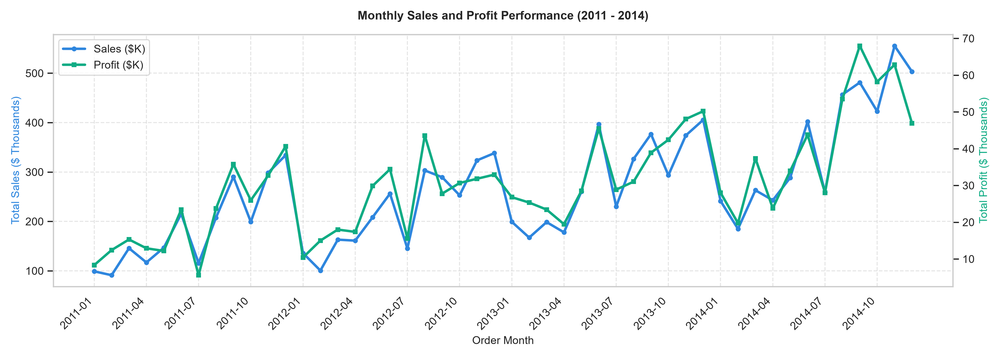
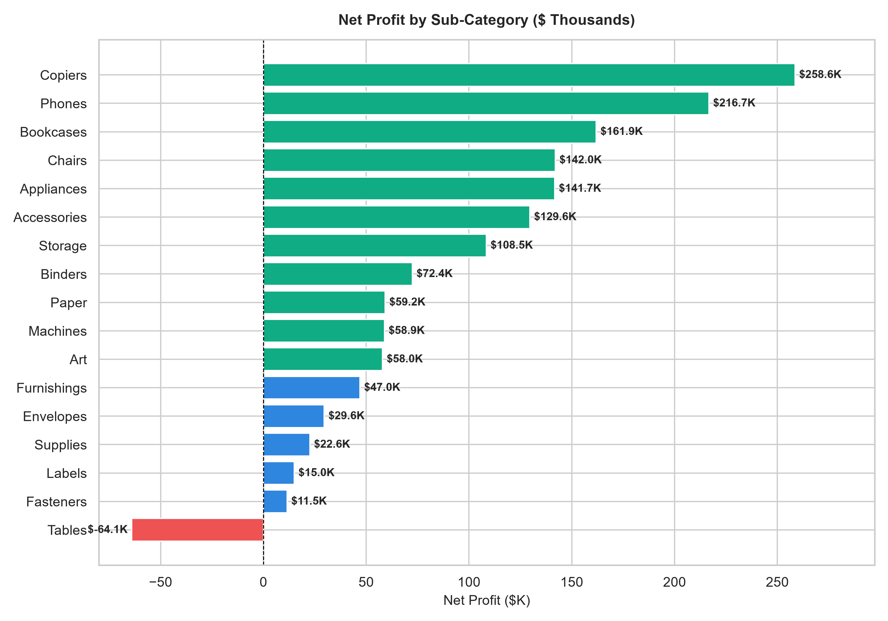

# 🏪 SuperStore Global Sales & Profitability Analytics

[](https://www.python.org/)
[](https://streamlit.io/)
[](https://www.sqlite.org/)
[](LICENSE)
[](tests/)

An end-to-end, production-grade Data Analytics portfolio project analyzing **51,290 retail transactions** across **165 countries** and **7 global markets**. Demonstrates the full analytics lifecycle: automated ETL data cleaning, relational SQLite modeling with advanced window functions, exploratory data analysis, publication-grade reporting, and an interactive Streamlit Business Intelligence dashboard.

---

## 🎯 Executive Overview & Business Problem

A global retail enterprise operating across 7 continental markets (APAC, EU, US, LATAM, EMEA, Africa, Canada) experienced strong top-line sales growth (+90.3% from 2011 to 2014) reaching **\$12.64M in total revenue**. However, operating margins remained stagnant around ~11.6%, and leadership sought to understand:

1. **Where is profit leaking?** Which products, regions, and operational tiers are eroding enterprise margins?
2. **What is the true cost of discounting?** Is price discounting driving incremental profitable volume or subsidizing value destruction?
3. **How do fulfillment and shipping modes affect profitability?** Are logistics operations scaling efficiently?

### Headline Figures (2011 – 2014)
- **Total Revenue:** \$12,642,905.00
- **Net Operating Profit:** \$1,469,034.82
- **Unique Orders:** 25,035 orders (51,290 order lines)
- **Overall Operating Profit Margin:** 11.62%
- **Average Order Value (AOV):** \$505.01
- **Loss-making Transactions Drag:** 12,543 transactions (24.5%) produced **-\$920,357.39 in cumulative losses**.

---

## 🏗️ Project Architecture & Structure

```
superstore-sales-analytics/
│
├── data/
│   ├── raw/                                 # Original immutable CSV dataset
│   │   └── SuperStoreOrders - SuperStoreOrders.csv
│   ├── processed/                           # Cleaned & feature-engineered dataset
│   │   └── superstore_cleaned.csv
│   └── superstore.db                        # Relational SQLite database with indexes
│
├── src/                                     # Reusable Python modules
│   ├── __init__.py
│   ├── data_cleaning.py                     # Automated cleaning & feature engineering pipeline
│   ├── analysis.py                          # Metric aggregation & business calculation functions
│   ├── database.py                          # SQLite database builder & query runner
│   └── generate_figures.py                  # High-res publication chart generator
│
├── sql/                                     # Production SQL queries
│   ├── schema.sql                           # SQLite table definitions & index creation
│   └── analysis_queries.sql                 # 17 advanced business queries (CTEs, Window, Ranking)
│
├── app/                                     # Interactive Streamlit BI Application
│   └── dashboard.py                         # Plotly charts, reactive filters, custom KPI metrics
│
├── notebooks/                               # Exploratory Data Analysis
│   └── exploratory_data_analysis.ipynb      # Fully executed 61-cell notebook with business narratives
│
├── reports/                                 # Business Deliverables
│   ├── figures/                             # 9 high-resolution PNG charts
│   └── business_insights.md                 # Formal business intelligence & recommendations report
│
├── tests/                                   # Automated test suite
│   ├── __init__.py
│   └── test_analysis.py                     # 24 unit & integration tests (100% passing)
│
├── requirements.txt                         # Pinned dependency manifest
├── README.md                                # Comprehensive documentation
└── .gitignore                               # Clean repository filter rules
```

---

## 🛠️ Technology Stack

| Domain | Tool / Library | Purpose & Rationale |
| :--- | :--- | :--- |
| **Language** | **Python 3.11 – 3.15** | Core language for data manipulation, analytics, and automation |
| **Data Processing** | **Pandas & NumPy** | High-performance vectorized transformation and feature engineering |
| **Relational Database** | **SQLite & SQL** | Portable, zero-config relational store with CTEs, window functions, and indexing |
| **Interactive BI** | **Streamlit** | Low-latency, reactive, modern web dashboard with multi-criteria filtering |
| **Visualization** | **Plotly, Matplotlib, Seaborn** | Interactive Plotly web visuals + crisp, 300 DPI publication plots |
| **Automated Testing** | **pytest** | 24 test cases validating ETL transforms, math edge cases, and data integrity |

---

## 📊 Key Findings & Strategic Insights

### 1. The Discount "Cliff" (Core Vulnerability)
- **0% Discount:** Generates an outstanding **25.32% profit margin** and **\$1.77M in profit** with zero loss transactions.
- **1% – 20% Discount:** Generates positive margins (17.3% to 9.9%).
- **21%+ Discount:** Crosses into severe negative returns. At **50%+ discounts**, **100.0% of all 4,172 transactions lost money**, destroying **-\$412,581.70** in net profit.
- **Finding:** Promotional discounts above 20% do not stimulate profitable volume; they guarantee losses.

### 2. The Tables Sub-Category Deficit
- While 16 out of 17 product sub-categories are profitable (led by **Copiers** at \$258.6K profit and **Phones** at \$216.7K), **Tables incurred a net loss of -\$64,083.39** globally on \$757K in sales (-8.47% margin).
- This is driven by high dimensional shipping costs coupled with an unsustainable 29.1% average promotional discount.

### 3. Geographic & Regional Disparities
- **Star Performers:** Canada (26.62% margin with 0% discount policy), North Asia (19.52% margin), and Central Asia (17.60% margin).
- **Underperforming Regions:** Southeast Asia generated \$884K in revenue but only **\$17.8K in profit (2.02% margin)** due to unchecked discounting (27.2% avg discount). EMEA similarly lagged at a 5.45% margin.


*Figure 1: Monthly Sales and Profit Growth (2011–2014) demonstrating Q4 seasonal surges.*


*Figure 2: Net Profit across 17 sub-categories highlighting the Tables deficit.*

---

## 💻 SQL Analysis Capabilities

The project includes **17 documented SQL queries** in [`sql/analysis_queries.sql`](sql/analysis_queries.sql) demonstrating core data analyst competencies:

1. **Common Table Expressions (CTEs):** Multi-stage profitability waterfall and contribution percentages.
2. **Window Functions:**
   - `LAG() OVER (...)`: Month-over-month and Year-over-year revenue momentum.
   - `RANK() / DENSE_RANK()`: Ranking global markets by profitability vs sales volume.
   - `SUM() OVER (ORDER BY ... ROWS BETWEEN ...)`: Cumulative running total revenue and Pareto contribution curves.
3. **Conditional Aggregation (`CASE WHEN`):** Grouping orders into dynamic discount tiers and margin health classifications.
4. **Data Aggregations:** Multi-level `GROUP BY`, `HAVING`, and date formatting functions.

Run all SQL queries directly with:
```bash
python src/database.py
```

---

## 🚀 Installation & How to Run

### 1. Clone the Repository
```bash
git clone https://github.com/your-username/superstore-sales-analytics.git
cd superstore-sales-analytics
```

### 2. Set Up Virtual Environment & Dependencies
```bash
# Windows
python -m venv venv
venv\Scripts\activate

# Install requirements
pip install -r requirements.txt
```

### 3. Execute the ETL Pipeline & Database Build
```bash
# Clean raw data, engineer features, and validate
python src/data_cleaning.py

# Build SQLite database and execute analysis queries
python src/database.py

# Generate report figures
python src/generate_figures.py
```

### 4. Launch the Interactive Streamlit Dashboard
```bash
streamlit run app/dashboard.py
```
*The dashboard will automatically open in your browser at `http://localhost:8501`.*

### 5. Run the Automated Test Suite
```bash
pytest tests/ -v
```

---

## 📱 Interactive Dashboard Features

- **Dynamic Global Filters:** Multi-select slicers for Year, Market, Region, Product Category, Customer Segment, and Ship Mode.
- **Reactive KPI Header:** Total Sales, Net Profit, Total Orders, Profit Margin %, and Average Order Value update dynamically.
- **Plotly Visualizations:**
  - Monthly Sales & Profit Trendlines
  - Sales by Category & Profit by Sub-Category
  - Global Market Sales Volume & Regional Margins
  - Customer Segment Revenue Share (Pie) & Discount vs Profit Scatter
  - Top 10 Best-Selling Products & Top 10 High-Value Customers

---

## 💼 Portfolio & Resume Content

### 📄 Bullet Points for Your Resume
> **Data Analyst — SuperStore Global Sales & Profitability Project (Python, SQL, Streamlit, Plotly)**
> - Engineered an automated ETL pipeline in Python (Pandas) to clean, validate, and enrich 51,290 global retail records across 165 countries, resolving date parsing anomalies and thousand-separator data types.
> - Modeled a relational SQLite database and authored 17 advanced analytical queries utilizing CTEs, window functions (`LAG`, `RANK`, running totals), and conditional aggregations (`CASE WHEN`).
> - Uncovered an empirical discount "cliff" proving discounts $>20\%$ caused \$814K in net losses (with 50%+ discounts yielding a 100% transaction failure rate); formulated data-backed discount capping recommendations.
> - Developed an interactive Streamlit BI dashboard featuring 10 Plotly visualizations with multi-criteria dynamic filtering, KPI cards, and responsive custom CSS styling.
> - Authored an automated pytest test suite (24 unit/integration tests) ensuring zero null anomalies and verifying mathematical edge cases.

### 🌐 LinkedIn Post Template
```text
Excited to share my latest end-to-end Data Analytics project: SuperStore Global Sales & Profitability Analytics! 📊 🚀

Analyzing 51,290 global transactions across 165 countries and 7 markets, I explored the relationship between promotional discounting, operational fulfillment, and bottom-line profit.

Key Highlights:
🔹 The Discount Cliff: While 0% discount orders achieved a 25.3% margin ($1.77M profit), discounts above 20% completely eroded profitability. In fact, orders with 50%+ discounts had a 100% loss rate, destroying $412K in value.
🔹 Product Insights: 16 out of 17 sub-categories were profitable (led by Copiers and Phones), but Tables generated an aggregate loss of -$64K globally.
🔹 Modern Stack: Automated ETL in Python/Pandas, relational modeling in SQLite with advanced window functions (LAG, RANK, CTEs), an interactive Streamlit dashboard with Plotly charts, and 24 passing pytest unit tests.

Check out the full repository and interactive dashboard here: [Your GitHub Repo Link]

#DataAnalytics #Python #SQL #Streamlit #DataVisualization #BusinessIntelligence #Portfolio
```

### 🏷️ Suggested GitHub Repository Metadata
- **Description:** `End-to-End SuperStore Sales & Profitability Analytics: Python ETL, SQLite with Window Functions, Streamlit Interactive Dashboard, and EDA.`
- **Topics:** `data-analytics`, `python`, `sql`, `streamlit`, `plotly`, `eda`, `business-intelligence`, `data-cleaning`, `sqlite`, `portfolio-project`

---

## 🔮 Future Enhancements
- [ ] Implement automated machine learning forecasting (ARIMA / Prophet) for Q4 inventory demand.
- [ ] Add Customer Lifetime Value (CLV) and RFM (Recency, Frequency, Monetary) customer segmentation.
- [ ] Containerize the application with Docker for one-click cloud deployment on AWS / Streamlit Community Cloud.

---

## 📜 License
This project is licensed under the MIT License — see the [LICENSE](LICENSE) file for details.
