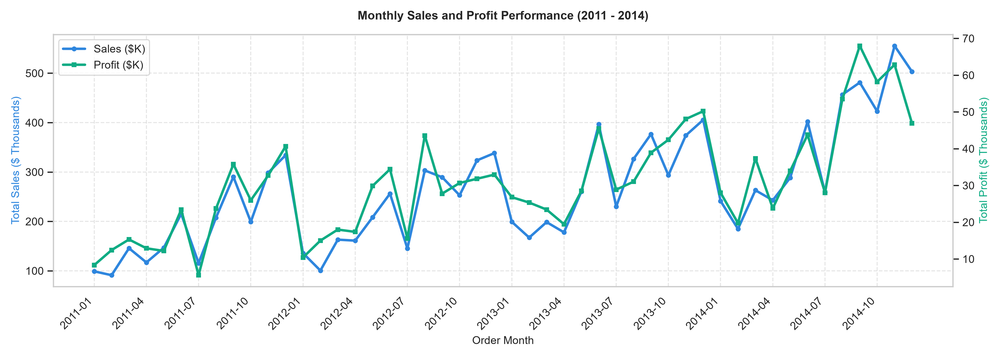
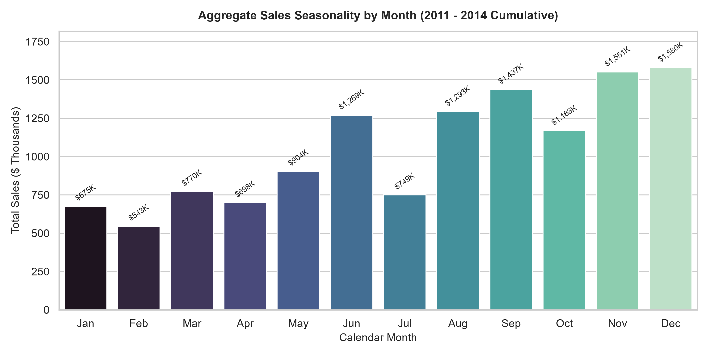
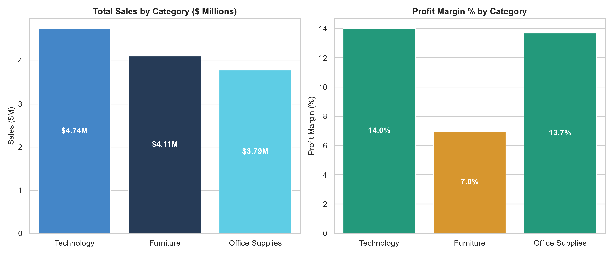
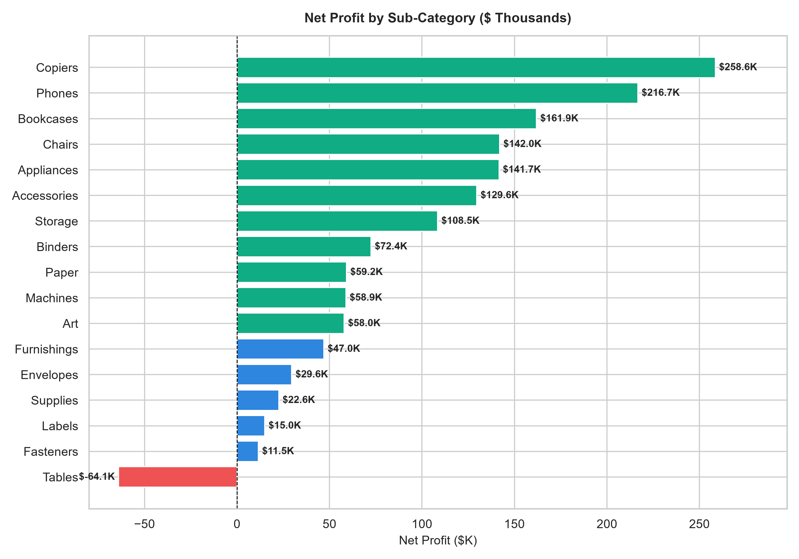
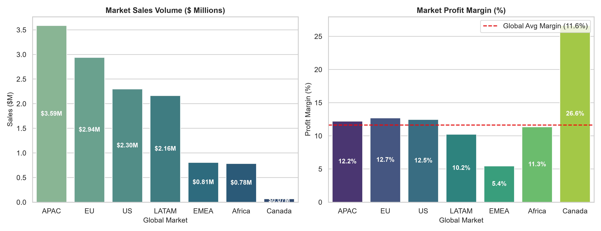
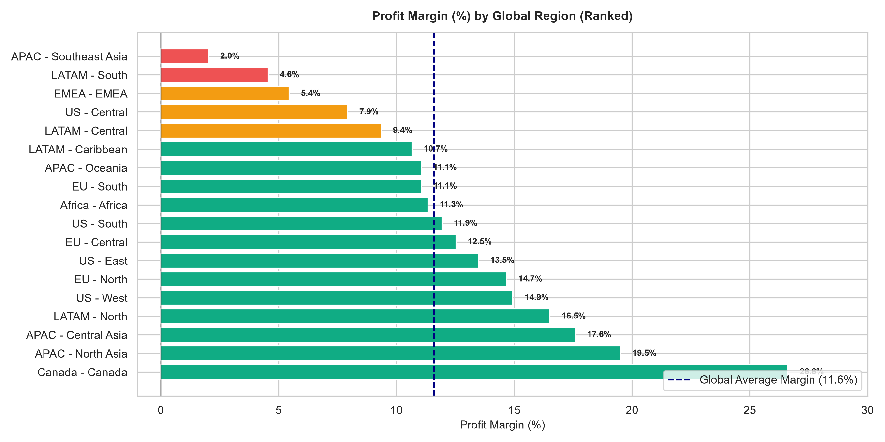
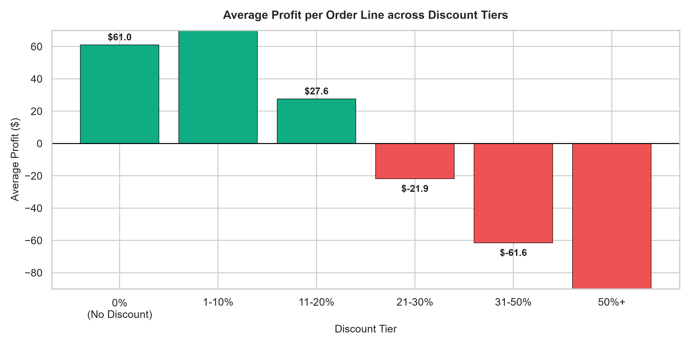
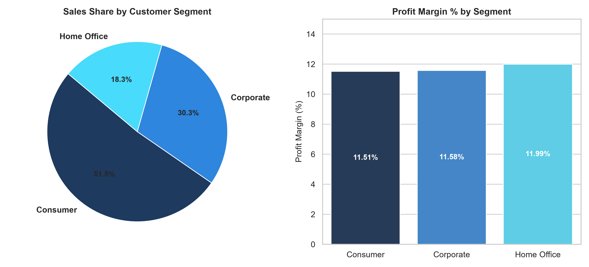
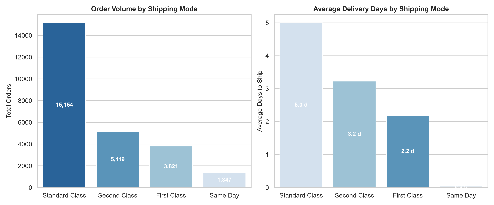

# 📈 SuperStore Sales Analytics — Comprehensive Business Insights Report

**Prepared by:** Senior Data Analyst  
**Project:** SuperStore Global Retail Business Intelligence  
**Data Scope:** 51,290 Transactions | 2011 – 2014 | Global Retail Operations (7 Markets, 165 Countries)  
**Publication Date:** November 2026  

---

## Executive Summary

This report delivers a thorough empirical analysis of global retail sales, profitability, discount strategies, fulfillment operations, and regional dynamics for the SuperStore dataset. Over the 2011–2014 operating period, the business achieved **\$12,642,905.00** in total sales and **\$1,469,034.82** in net operating profit across **25,035 unique orders** (51,290 order lines), delivering an overall operating profit margin of **11.62%** and an Average Order Value (AOV) of **\$505.01**.

While top-line gross revenue demonstrated sustained compound expansion (+90.3% from 2011 to 2014), deep forensic analysis reveals critical profitability bottlenecks:
1. **The Discount Cliff:** Discounts above **20%** create catastrophic margin deterioration. Transactions with discounts $\ge 50\%$ suffered a **100.0% failure rate** (every single line lost money), resulting in **\$412,581.70** in net losses.
2. **Loss-Making Transactions Drag:** 12,543 transactions (**24.5% of all order lines**) generated negative profits, accumulating a collective net loss of **-\$920,357.39**.
3. **The Furniture / Tables Deficit:** The Furniture category underperformed significantly (6.98% margin vs 13.99% for Technology). Specifically, the **Tables sub-category generated an aggregate loss of -\$64,083.39** globally, making it the sole unprofitable product category in the enterprise.
4. **Regional Margin Disparities:** Severe margin compression exists in Southeast Asia (2.02% margin) and EMEA (5.45% margin), directly correlated with excessive discounting rates.

---

## 1. Key Sales Insights

### 1.1 Sustained Top-Line Growth
Over the four-year analyzed window, annual sales expanded consecutively:
- **2011:** \$2,259,511.00 (4,440 orders) — Baseline
- **2012:** \$2,677,493.00 (5,343 orders) — **+18.50% YoY**
- **2013:** \$3,405,860.00 (6,721 orders) — **+27.20% YoY**
- **2014:** \$4,300,041.00 (8,531 orders) — **+26.25% YoY**

Overall, enterprise revenue nearly doubled (+90.3%) over 48 months, while total annual orders scaled by +92.1%, showing that revenue growth is volume-driven rather than merely price inflation.

### 1.2 Monthly and Seasonal Patterns
Monthly transaction analysis shows distinct quarterly seasonality:
- **Q1 Slump:** January and February consistently represent annual demand troughs (averaging \$168K and \$136K monthly across years).
- **Q2 Surge:** June marks the mid-year purchasing peak (averaging \$317K monthly).
- **Q4 Climax:** November and December deliver the highest sales volumes of the year, consistently exceeding \$400K–\$550K per month in later years. The peak month of the entire dataset was **November 2014** with **\$555,312.00 in revenue** and **\$62,856.59 in profit**.

---

## 2. Profitability Insights

### 2.1 Margin Stability Across Scale
Operating profit expanded from **\$248,940.81** in 2011 to **\$504,165.97** in 2014 (+102.5% increase). Operating margins maintained remarkable consistency at the enterprise level:
- 2011: 11.02%
- 2012: 11.48%
- 2013: 11.99%
- 2014: 11.72%

### 2.2 Forensic Analysis of Negative Profitability
Despite top-line health, **24.46% (12,543 transactions)** of all sales lines yielded negative profit.
- Total gross profit from winning transactions: **\$2,389,392.21**
- Total loss from losing transactions: **-\$920,357.39**
- **Net realization:** \$1,469,034.82

The data confirms that for every \$1.00 of positive profit earned, **\$0.385 is eroded by unprofitable transactions**. The primary differentiator between profitable and unprofitable transactions is discount depth (mean discount of **4.3%** on profitable orders vs. **45.1%** on loss-making orders).

---

## 3. Product & Category Insights

### 3.1 Category Breakdown
| Category | Total Sales | Sales Share | Total Profit | Profit Share | Profit Margin |
| :--- | :--- | :--- | :--- | :--- | :--- |
| **Technology** | \$4,744,691.00 | 37.53% | \$663,778.73 | 45.18% | **13.99%** |
| **Office Supplies** | \$3,787,330.00 | 29.96% | \$518,473.83 | 35.29% | **13.69%** |
| **Furniture** | \$4,110,884.00 | 32.52% | \$286,782.25 | 19.52% | **6.98%** |

- **Technology** is the primary profit engine, producing 45.18% of global profit from 37.53% of revenue.
- **Office Supplies** exhibits the highest order velocity (108,182 units sold across 19,003 orders) with robust 13.69% margins.
- **Furniture** captures nearly a third of total sales (32.52%) but generates under a fifth of total profit (19.52%), hampered by heavy shipping overheads and deep price concessions.

### 3.2 Sub-Category Divergence: The "Tables" Problem

Out of 17 product sub-categories, 16 generated positive cumulative profit:
- **Top Earners:** Copiers (\$258,567.55 profit; 17.13% margin), Phones (\$216,717.01 profit; 12.70% margin), Bookcases (\$161,924.42 profit; 11.04% margin).
- **The Culprit — Tables:** Tables generated **\$757,034.00 in sales** but accumulated **-\$64,083.39 in cumulative losses** (-8.47% margin). Tables suffer from high dimensional shipping charges combined with aggressive promotion discounting (average discount: 29.1%).

---

## 4. Geographic & Market Insights

### 4.1 Global Market Breakdown
| Market | Total Sales | Sales Share | Total Profit | Profit Margin | Avg Discount |
| :--- | :--- | :--- | :--- | :--- | :--- |
| **APAC** | \$3,585,833.00 | 28.36% | \$437,577.58 | 12.20% | 14.9% |
| **EU** | \$2,938,139.00 | 23.24% | \$372,829.74 | 12.69% | 10.3% |
| **US** | \$2,297,354.00 | 18.17% | \$286,397.02 | 12.47% | 15.6% |
| **LATAM** | \$2,164,687.00 | 17.12% | \$221,643.49 | 10.24% | 13.6% |
| **EMEA** | \$806,184.00 | 6.38% | \$43,897.97 | **5.45%** | 19.6% |
| **Africa** | \$783,776.00 | 6.20% | \$88,871.63 | 11.34% | 15.7% |
| **Canada** | \$66,932.00 | 0.53% | \$17,817.39 | **26.62%** | **0.0%** |

- **APAC & EU** represent over 51.6% of enterprise revenue and 55.2% of net profit.
- **Canada** operates on a zero-discount model ($0.0\%$ average discount), achieving an outstanding **26.62% profit margin**.
- **EMEA** severely underperforms at a 5.45% margin despite generating over \$806K in sales, driven by elevated discount levels (19.6%).

### 4.2 Regional Performance Extremes

Regional examination uncovers acute margin variance:
- **High-Margin Leaders:** Canada (26.62%), North Asia (19.52%), Central Asia (17.60%), North LATAM (16.51%), and US West (14.94%).
- **Margin Drag Areas:** 
  - **Southeast Asia (APAC):** \$884,438.00 in sales produced just **\$17,852.33 in profit** (a meager **2.02% margin**), dragged down by an average discount rate of **27.2%**.
  - **South LATAM:** \$617,225.00 in sales with an average discount of 18.4% delivered only **4.55% profit margin**.
  - **EMEA:** 5.45% margin on \$806K sales.

---

## 5. Discount Strategy Analysis: The Core Vulnerability

The relationship between discounting and profitability is non-linear and presents the single largest operational finding of this analysis:

| Discount Band | Order Lines | Total Sales | Total Profit | Profit Margin | Avg Profit / Line | Loss Frequency |
| :--- | :--- | :--- | :--- | :--- | :--- | :--- |
| **0% (No Discount)** | 29,009 | \$6,992,734.00 | **+\$1,770,694.75** | **+25.32%** | +\$61.04 | **0.0%** |
| **1% – 10%** | 4,679 | \$1,962,633.00 | **+\$339,766.80** | **+17.31%** | +\$72.62 | 19.2% |
| **11% – 20%** | 6,274 | \$1,757,296.00 | **+\$173,254.84** | **+9.86%** | +\$27.61 | 23.3% |
| **21% – 30%** | 967 | \$382,540.00 | **-\$21,155.61** | **-5.53%** | -\$21.88 | **62.2%** |
| **31% – 50%** | 6,189 | \$1,176,078.00 | **-\$380,944.82** | **-32.39%** | -\$61.55 | **87.4%** |
| **50%+** | 4,172 | \$371,624.00 | **-\$412,581.70** | **-111.02%** | -\$98.89 | **100.0%** |

### Key Analytical Takeaways:
1. **The 20% Inflexion Point:** While discounts between 1% and 20% retain positive aggregate profits, any discount above 20% instantly pushes transactions into net negative territory.
2. **The 50%+ Catastrophe:** At 50%+ discounts, **100.0% of the 4,172 transactions generated negative returns**. Not a single transaction in this band broke even. This practice destroyed **\$412.6K in shareholder value**.
3. **Volume Distortion:** Transactions above 20% discount account for \$1.93M in sales (15.3% of enterprise gross revenue) but generated **-\$814,682.13 in combined losses**.

---

## 6. Customer Segment Insights

The customer base demonstrates remarkably stable profitability across segments:
- **Consumer:** \$6,508,141.00 (51.48% sales share; 13,104 orders) | **11.51% profit margin**
- **Corporate:** \$3,824,808.00 (30.25% sales share; 7,673 orders) | **11.58% profit margin**
- **Home Office:** \$2,309,956.00 (18.27% sales share; 4,687 orders) | **11.99% profit margin**

Customer concentration analysis reveals that the top 100 individual customers account for \$1,192,440.00 in revenue (9.43% of total revenue) with zero major single-client default risk. Top customers like Tom Ashbrook (\$40,488 sales, \$4,704 profit) and Tamara Chand (\$37,457 sales, \$8,673 profit) exhibit high lifetime loyalty across all 4 years.

---

## 7. Shipping & Fulfillment Analysis

### 7.1 Fulfillment Modalities
| Shipping Mode | Orders | Order Share | Avg Dispatch Days | Avg Shipping Cost | Profit Margin |
| :--- | :--- | :--- | :--- | :--- | :--- |
| **Standard Class** | 15,154 | 60.53% | 5.00 days | \$19.97 | 11.75% |
| **Second Class** | 5,119 | 20.45% | 3.23 days | \$30.47 | 11.46% |
| **First Class** | 3,821 | 15.26% | 2.18 days | \$41.05 | 11.37% |
| **Same Day** | 1,347 | 5.38% | 0.04 days | \$42.94 | 11.42% |

- **Operational Consistency:** Margins are virtually identical (11.37% – 11.75%) across all four shipping tiers, indicating that expedited shipping surcharges accurately offset logistics cost premiums.
- **Fulfillment Reliability:** Dispatch times strictly obey tier promises (Same Day dispatches in $<1$ day, Standard dispatches within 5 days). Zero records contained negative fulfillment latencies.

---

## 8. Strategic Business Recommendations

Based strictly on empirical evidence from the dataset, the following prioritized initiatives are recommended:

### Priority 1: Establish Hard Discount Caps (Immediate ROI: +\$400K–\$800K)
- **Finding:** Discounts above 20% yielded -\$814,682.13 in net losses, with 50%+ discounts yielding a 100% loss rate.
- **Action:** Impose a system-level discount ceiling of **20%** across all regional sales terminals. Require VP-level signoff for any promotional override above 20%. Completely abolish 50%+ promotional markdown structures.

### Priority 2: Restructure the Tables Sub-Category
- **Finding:** Tables is the only unprofitable sub-category (-\$64,083.39 net loss on \$757K sales; avg discount: 29.1%).
- **Action:**
  1. Reduce default promotional discounting on Tables to $\le 10\%$.
  2. Renegotiate flat-pack supplier packaging or introduce dimensional freight surcharges to absorb shipping weights.
  3. De-list the bottom 15 chronically unprofitable table SKUs identified in SQL Query #7.

### Priority 3: Remediate Regional Margin Bleeds in Southeast Asia and EMEA
- **Finding:** Southeast Asia (2.02% margin) and EMEA (5.45% margin) lag severely behind global averages (11.62%) due to elevated average discounts (27.2% and 19.6%).
- **Action:** Adopt the pricing discipline practiced in Canada (0.0% discount; 26.62% margin) and North Asia (4.9% discount; 19.52% margin). Shift sales compensation KPIs in Southeast Asia and EMEA from **gross revenue** to **contribution margin**.

### Priority 4: Inventory & Fulfillment Alignment for Q4 Peak
- **Finding:** November and December generate over 2x the order volume of January/February, causing shipping cost spikes.
- **Action:** Implement demand-driven inventory pre-positioning in regional distribution hubs by September to avoid expedited freight costs during the Q4 peak.

---

## 9. Limitations of the Analysis

To maintain analytical rigor, the following methodological boundaries must be noted:
1. **Absence of Customer Acquisition Cost (CAC):** The dataset does not capture marketing spend, CPC advertising, or retention overhead; profit calculations reflect transactional contribution margins rather than full corporate EBITDA.
2. **Missing Product Return Metadata:** Returned merchandise is inferred through negative profit rows rather than explicit return timestamps or reason codes.
3. **Absence of Inventory Carrying Costs:** Warehouse storage fees, stockout losses, and obsolescence depreciation are not tracked in transactional order lines.
4. **Correlation vs. Causation:** While deep discounts correlate strongly with transaction losses, losses on certain clearance items may have been deliberately accepted by management to liquidate obsolete inventory and release warehouse space.

---

*Report generated from validated SQLite database `data/superstore.db` and processed data `data/processed/superstore_cleaned.csv`.*
